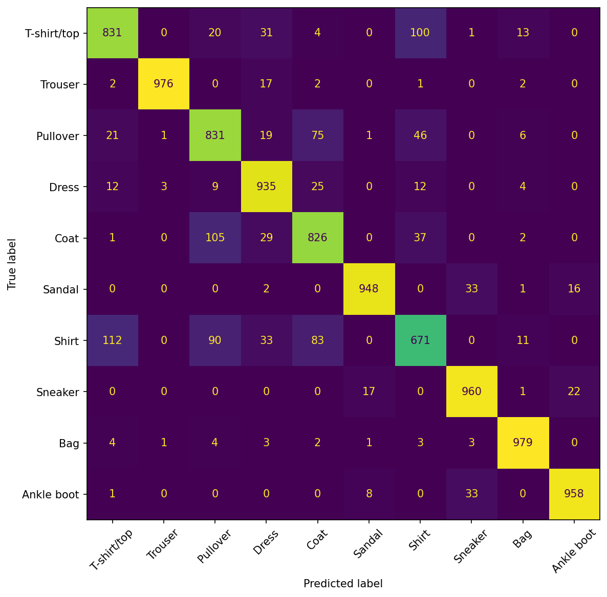

# Sprawozdanie laboratoryjne

**Przedmiot:** Uczenie głębokie do rozpoznawania obiektów
**Zajęcia nr / temat:** 1 / Obraz jako dane; pierwszy klasyfikator obrazów (MLP)
**Autor / grupa:** Jakub Powroźnik, grupa 5.03
**Data:** 14.10.2026

## 1. Cel ćwiczenia

Ćwiczenie polegało na wytrenowaniu perceptronu wielowarstwowego (MLP) do klasyfikacji obrazów, porównaniu kilku architektur, zbadaniu przeuczenia na krzywych uczenia oraz przeanalizowaniu najczęstszych błędów modelu.

Wybrałem zbiór FashionMNIST. Jest to prosty zbiór (obrazy 28×28 w skali szarości, 1 kanał), dzięki czemu trening MLP jest szybki nawet na CPU i można przetestować wiele wariantów architektury. Jednocześnie zbiór zawiera podobne do siebie klasy (np. Shirt, T-shirt/top, Pullover, Coat), co pozwala na ciekawą analizę błędów. CIFAR-10 odrzuciłem, bo obrazy kolorowe i bardziej zróżnicowane są dla MLP znacznie trudniejsze.

## 2. Metoda i implementacja

**Narzędzia:** Python 3.12, PyTorch, torchvision, matplotlib, pandas, NumPy oraz scikit-learn (macierz pomyłek). Całość wykonana w notebooku Jupyter (VS Code), trening na CPU.

**Dane:** Zbiór FashionMNIST pobrany przez `torchvision.datasets`: 60 000 obrazów treningowych i 10 000 testowych, 10 klas, obrazy 28×28 w skali szarości. Obrazy przekształcono przez `ToTensor()` (skalowanie do zakresu 0–1) oraz `Normalize(0.5, 0.5)` (zakres od −1 do 1). Dane podawane są przez `DataLoader` z paczkami po 64 obrazy, z tasowaniem dla zbioru treningowego (`shuffle=True`) i bez tasowania dla testowego. Pojedyncza paczka ma kształt `[64, 1, 28, 28]`.

**Model:** Perceptron wielowarstwowy budowany funkcją `build_mlp(hidden_sizes)` o strukturze `Flatten → [Linear → ReLU] × n → Linear(…, 10)`. Wyjściem jest 10 logitów (bez softmaxa, ponieważ `CrossEntropyLoss` zawiera go w sobie).

```python
def build_mlp(hidden_sizes, in_dim=784, out_dim=10):
    layers = [nn.Flatten()]
    prev = in_dim
    for h in hidden_sizes:
        layers.append(nn.Linear(prev, h))
        layers.append(nn.ReLU())
        prev = h
    layers.append(nn.Linear(prev, out_dim))
    return nn.Sequential(*layers)
```

Przetestowano trzy architektury warstw ukrytych:

| Architektura | Liczba parametrów | Uwagi |
|---|---|---|
| (128,) | 101 770 | wariant 1 |
| (256, 128) | 235 146 | wariant 2, także model bazowy |
| (512, 256, 128) | 567 434 | wariant 3 |

**Trening:** Funkcja straty `CrossEntropyLoss`, optymalizator Adam, współczynnik uczenia 1e-3. Przed utworzeniem każdego modelu ustawiano `torch.manual_seed(0)`. Model bazowy (256, 128) trenowano przez 3 epoki. Trzy warianty architektury trenowano osobno po 10 oraz po 20 epok, każdy od nowa. Po każdej epoce liczono stratę i accuracy na zbiorze treningowym i testowym (strata uśredniana po przykładach). W tabeli wyników podano accuracy testowe po ostatniej epoce.

Ponieważ model bazowy i wariant (256, 128) mają ten sam seed i hiperparametry, przebieg bazowego jest identyczny z pierwszymi trzema epokami wariantu (256, 128). Porównanie z baseline pokazuje więc w praktyce wpływ liczby epok dla tej samej architektury.

**Kod:** pełny kod znajduje się w notebooku `lab1_JP.ipynb` w repozytorium .

## 3. Wyniki

### 3.1 Model bazowy

Model bazowy (256, 128), trenowany przez 3 epoki, osiągnął **86,57%** accuracy na zbiorze testowym (strata testowa 0,370; accuracy treningowe 87,70%). Jest to punkt odniesienia dla pozostałych wariantów.

### 3.2 Porównanie architektur

| Architektura | Liczba parametrów | Accuracy testowe, 10 epok | Accuracy testowe, 20 epok |
|---|---|---|---|
| (128,) | 101 770 | 87,80% | 87,81% |
| (256, 128) | 235 146 | 88,60% | 88,89% |
| (512, 256, 128) | 567 434 | 87,69% | **89,15%** |

Wszystkie warianty po 20 epokach przewyższają model bazowy (86,57%), przy czym znaczna część tej różnicy wynika po prostu z dłuższego treningu. Najlepszy wynik uzyskała architektura (512, 256, 128). Przy 10 epokach najlepsza była (256, 128), więc ranking zależy od liczby epok.

### 3.3 Krzywe uczenia


Krzywe dla najlepszego wariantu (512, 256, 128), 20 epok. Strata treningowa spada z ok. 0,50 do ok. 0,14. Strata testowa osiąga minimum (ok. 0,34) w epoce 8 (licząc od 0), następnie rośnie do ok. 0,41 w epokach 16–17 i kończy na ok. 0,39. Accuracy w ostatniej epoce: 94,7% (trening) i 89,2% (test).

### 3.4 Przykładowe predykcje


Siatka przedstawia jedną paczkę testową (64 obrazy) sklasyfikowaną przez model (512, 256, 128) po 20 epokach: 9 trafnych predykcji (zielone tytuły) i wszystkie 7 błędnych z tej paczki (czerwone). Tytuł ma postać `predykcja / prawdziwa klasa`. Accuracy na tej paczce wynosi 89,06%.

### 3.5 Macierz pomyłek



Macierz pomyłek na całym zbiorze testowym (10 000 obrazów) dla modelu (512, 256, 128) po 20 epokach. Najczęstsza pomyłka to Shirt → T-shirt/top (112 przypadków). Klasa Shirt ma najniższą skuteczność (671/1000), a najwyższą Bag (979/1000) i Trouser (976/1000).

## 4. Analiza i interpretacja

**Wpływ architektury.** Różnice między wariantami są małe: po 20 epokach 87,81%, 88,89% i 89,15%, czyli ok. 1,3 p.p. między najgorszym a najlepszym. Największa sieć (512, 256, 128) wygrała dopiero przy 20 epokach, a przy 10 była najsłabsza (87,69%), co sugeruje, że potrzebuje więcej czasu na uczenie. Najmniejsza sieć (128,) praktycznie nie zyskała na dłuższym treningu (87,80% → 87,81%). Większa liczba parametrów nie dała więc wyraźnej poprawy. Wyniki pochodzą z jednego przebiegu, a accuracy testowe waha się między kolejnymi epokami o ok. 0,5–1 p.p., więc przy innym seedzie kolejność wariantów mogłaby być inna.

**Przeuczenie.** Strata treningowa maleje przez wszystkie 20 epok (z ok. 0,50 do ok. 0,14). Strata testowa ma minimum (ok. 0,34) w okolicy epoki 8 (licząc od 0), a potem rośnie i kończy na ok. 0,39. Rosnąca luka między krzywymi wskazuje na przeuczenie. Accuracy testowe mimo to nie spadło (89,15% po 20 epokach), ponieważ strata mierzy też pewność predykcji, a accuracy tylko to, czy model trafił. Możliwe, że model staje się zbyt pewny swoich błędnych odpowiedzi, ale tego nie weryfikowano.

**Błędy modelu.** Najtrudniejszą parą klas jest Shirt i T-shirt/top: 112 koszul zostało sklasyfikowanych jako T-shirt, a 100 T-shirtów jako koszula. Klasa Shirt ma najniższą skuteczność, wynoszącą 67,1%, i myli się też z Pullover (90) oraz Coat (83). Kolejną trudną parą jest Pullover i Coat: 105 płaszczy zostało sklasyfikowanych jako Pullover, a 75 pullowerów jako Coat. Są to ubrania górnej części ciała o podobnym kształcie, a MLP po spłaszczeniu obrazu nie wykorzystuje lokalnych wzorców, więc słabo odróżnia drobne szczegóły (kołnierz, guziki, długość rękawa). Najlepiej rozpoznawane są klasy o wyraźnie odmiennym kształcie, np. Trouser (976/1000), Bag (979/1000) oraz obuwie (Sandal 948, Sneaker 960, Ankle boot 958 na 1000), choć obuwie też częściowo się myli (Sandal → Sneaker i Ankle boot → Sneaker po 33 przypadki). Siatka predykcji potwierdza ten obraz: większość pomyłek w pokazanej paczce dotyczyła Shirt, Pullover, Coat i T-shirt/top.

**Ograniczenia.**
- Nie wydzielono zbioru walidacyjnego, więc zbiór testowy służył zarówno do oceny, jak i do porównania wariantów. Podane accuracy może być nieco optymistyczne.
- Pojedynczy przebieg, jeden seed.
- Model bazowy (3 epoki) i warianty (10 i 20 epok) trenowano różną liczbą epok, więc różnica względem baseline wynika w dużej mierze z dłuższego treningu.
- Podawane accuracy to wynik po ostatniej epoce. Dla niektórych wariantów wynik w którejś z wcześniejszych epok był wyższy (np. dla (256, 128) ok. 89,3% w epoce 15), co wskazuje na szum między epokami.
- Siatka predykcji i macierz pomyłek pochodzą z modelu (512, 256, 128) po 20 epokach, czyli już przeuczonego (strata testowa rośnie od ok. epoki 8).

## 5. Wnioski

Wytrenowano MLP na zbiorze FashionMNIST. Model bazowy (256, 128) osiągnął 86,57% accuracy na teście po 3 epokach, a najlepszy wariant (512, 256, 128) po 20 epokach 89,15%. Różnice między architekturami są jednak małe i pochodzą z jednego przebiegu, więc większa liczba parametrów nie daje gwarantowanej poprawy. Krzywe uczenia pokazały przeuczenie: strata treningowa maleje przez cały trening, a strata testowa przestaje spadać po ok. 8. epoce. Model najczęściej myli ubrania górnej części ciała (Shirt, T-shirt/top, Pullover, Coat), bo po spłaszczeniu obrazu MLP nie wykorzystuje lokalnych wzorców.

**Kierunki poprawy:** sieci konwolucyjne (wykorzystują lokalną strukturę obrazu), wcześniejsze zatrzymanie treningu (early stopping) i regularyzacja (np. dropout), wydzielenie zbioru walidacyjnego oraz powtórzenie eksperymentów dla kilku seedów.
