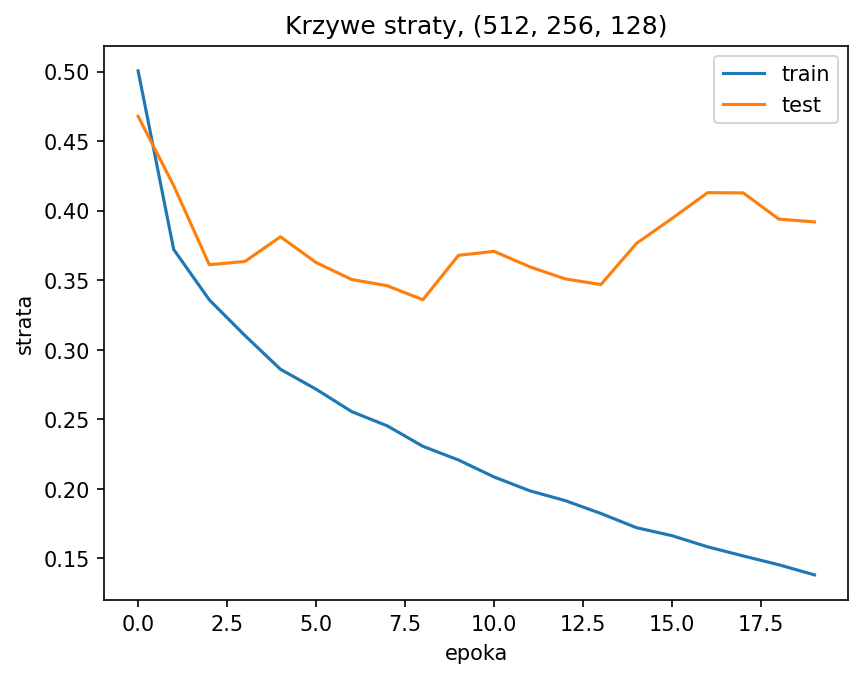
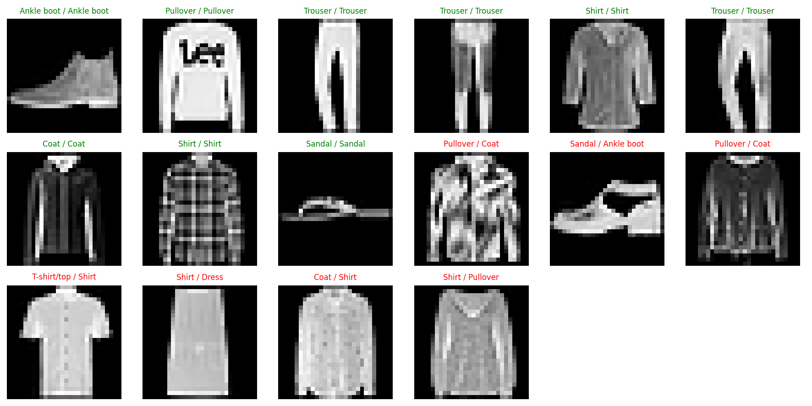

# Sprawozdanie laboratoryjne

**Przedmiot:** Uczenie głębokie do rozpoznawania obiektów
**Zajęcia nr / temat:** 1 / Obraz jako dane; pierwszy klasyfikator obrazów (MLP)
**Autor / grupa:** Jakub Powroźniki, grupa 5.03
**Data:** 14.10.2026

## 1. Cel ćwiczenia

Celem ćwiczenia było wytrenowanie prostej sieci MLP, która rozpoznaje rodzaj ubrania na zdjęciu, porównanie kilku architektur i sprawdzenie, w czym model się myli.

Wybrałem zbiór FashionMNIST. Jest prosty (obrazy 28×28 w skali szarości), więc trening jest szybki nawet na CPU i mogłem przetestować kilka wariantów. Są w nim też podobne do siebie klasy (np. Shirt i T-shirt/top), więc jest co analizować przy błędach. CIFAR-10 odrzuciłem, bo dla MLP jest dużo trudniejszy.

## 2. Metoda i implementacja

- **Dane:** FashionMNIST z `torchvision` (60 000 obrazów treningowych, 10 000 testowych, 10 klas). Obrazy przekształcone przez `ToTensor()` i `Normalize(0.5, 0.5)`, paczki po 64 obrazy.
- **Model:** funkcja `build_mlp`, która buduje sieć `Flatten → [Linear → ReLU] × n → Linear(…, 10)`. Na wyjściu jest 10 wartości (po jednej na klasę).
- **Trening:** `CrossEntropyLoss`, optymalizator Adam, learning rate 1e-3, `torch.manual_seed(0)` przed każdym modelem. Model bazowy trenowałem 3 epoki, a warianty architektury po 10 i po 20 epok. Po każdej epoce liczyłem stratę i accuracy na zbiorze treningowym i testowym.
- **Narzędzia:** Python, PyTorch, torchvision, matplotlib, pandas.
- **Kod:** notebook `lab1_JP.ipynb` w tym repozytorium: https://github.com/poverowoznik/rozpoznawanie_obiektow/tree/main/lab1

## 3. Wyniki

### 3.1 Model bazowy

Model bazowy to sieć (256, 128) trenowana 3 epoki. Na zbiorze testowym osiągnął **86,57%** accuracy.

### 3.2 Porównanie architektur

| Architektura | Liczba parametrów | Accuracy testowe (10 epok) | Accuracy testowe (20 epok) |
|---|---|---|---|
| (128,) | 101 770 | 87,80% | 87,81% |
| (256, 128) | 235 146 | 88,60% | 88,89% |
| (512, 256, 128) | 567 434 | 87,69% | **89,15%** |

Wszystkie warianty po 20 epokach są lepsze od modelu bazowego (86,57%), ale to głównie przez dłuższy trening. Najlepsza po 20 epokach jest sieć (512, 256, 128), a po 10 epokach była nią (256, 128).

### 3.3 Krzywe uczenia

Krzywe dla najlepszego wariantu (512, 256, 128), 20 epok.

### 3.4 Przykładowe predykcje

Jedna paczka testowa (64 obrazy) sklasyfikowana przez model (512, 256, 128): 9 trafnych predykcji (zielone) i 7 błędnych (czerwone). Tytuł to `predykcja / prawdziwa klasa`.

## 4. Analiza i interpretacja

**Architektury.** Różnice między wariantami są małe, po 20 epokach tylko ok. 1,3 punktu procentowego. Większa sieć nie dała wyraźnie lepszego wyniku, a wszystko pochodzi z jednego przebiegu, więc przy innym seedzie kolejność mogłaby wyjść inna.

**Przeuczenie.** Strata treningowa maleje przez wszystkie 20 epok (z ok. 0,50 do ok. 0,14). Strata testowa ma minimum (ok. 0,34) w okolicy 8. epoki, a potem rośnie i na końcu wynosi ok. 0,39. Rosnąca luka między krzywymi oznacza przeuczenie. Accuracy testowe mimo to nie spadło (89,15% po 20 epokach). Wydaje mi się, że to dlatego, że strata uwzględnia też pewność modelu, a accuracy tylko to, czy trafił, ale tego nie sprawdzałem.

**Błędy.** Na siatce prawie wszystkie błędy dotyczą ubrań na górę ciała: Shirt, T-shirt/top, Pullover i Coat. Potwierdza to macierz pomyłek z notebooka: najczęściej Shirt jest brany za T-shirt/top (112 przypadków), a Shirt ma najgorszą skuteczność (67,1%). Te ubrania mają podobny kształt, a MLP po spłaszczeniu obrazu nie widzi lokalnych wzorców, więc słabo odróżnia drobne szczegóły, jak kołnierz czy guziki. Najlepiej rozpoznawane są klasy o innym kształcie, np. Trouser i Bag (ponad 97%).

**Ograniczenie.** Nie robiłem osobnego zbioru walidacyjnego, więc zbiór testowy służył i do oceny, i do porównania wariantów.

## 5. Wnioski

Wytrenowałem MLP na FashionMNIST. Model bazowy dał 86,57% na teście, a najlepszy wariant (512, 256, 128) po 20 epokach 89,15%. Różnice między architekturami są małe, więc więcej parametrów nie dało dużej poprawy. Na krzywych widać przeuczenie, bo strata testowa przestaje spadać po ok. 8. epoce. Model najczęściej myli podobne ubrania na górę ciała (Shirt, T-shirt/top, Pullover, Coat). Żeby to poprawić, można by użyć sieci konwolucyjnej albo wcześniej zatrzymać trening.
