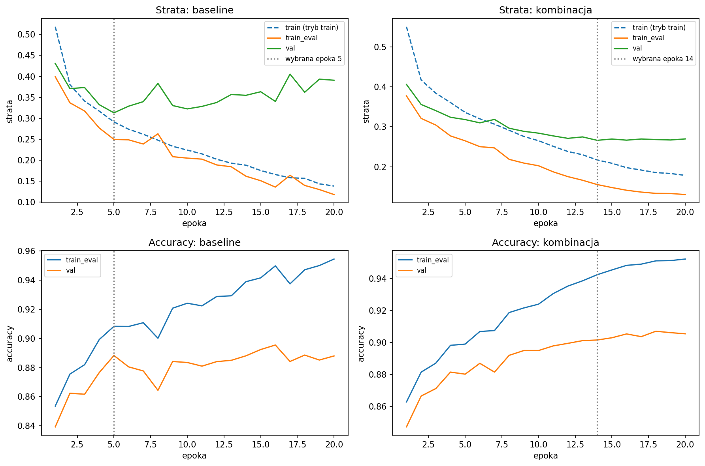

# Sprawozdanie laboratoryjne

**Przedmiot:** Uczenie głębokie do rozpoznawania obiektów
**Zajęcia nr / temat:** 2 — Trenowanie i strojenie klasyfikatora obrazów
**Autor / grupa:** Jakub Powroźnik Gr 5.03
**Data:** 26.10.2026

## 1. Cel ćwiczenia

Wziąć klasyfikator z zajęć 1 (MLP na FashionMNIST) jako baseline i spróbować poprawić jego jakość oraz to, jak działa na nowych danych. Sprawdzam kilka ulepszeń, każde osobno, i wybieram najlepszą konfigurację po stracie na walidacji. Test zostawiam na sam koniec.

## 2. Metoda i implementacja

**Narzędzia:** PyTorch, torchvision, matplotlib, pandas.

**Dane:** FashionMNIST (jak w zajęciach 1). Zbiór treningowy 60 000 obrazów podzieliłem na **50 000 trening / 10 000 walidacja** (losowo, seed 0), a oryginalny zbiór testowy (10 000) został do oceny końcowej. Indeksy podziału są zapisane w `split_idx.pt` i są takie same dla wszystkich wariantów. Normalizacja jak w Lab 1: `Normalize(0.5, 0.5)`.

**Model (baseline z Lab 1):** MLP 784 → 512 → 256 → 128 → 10, ReLU, 567 434 parametrów.

**Trening:** Adam, lr = 1e-3, batch 64, **20 epok dla każdego wariantu**, ten sam seed. Baseline: bez regularyzacji i bez augmentacji.

**Sprawdzone ulepszenia (każde osobno względem baseline'u):**
  - augmentacja (losowe odbicie poziome + `RandomCrop(28, padding=2)`, tylko na treningu),
  - BatchNorm,
  - dropout 0.3,
  - weight decay 1e-4,
  - scheduler (CosineAnnealing).

**Kombinacja:** połączyłem te ulepszenia, które osobno obniżyły stratę walidacyjną w porównaniu z baseline'em (wyszło: BatchNorm + dropout 0.3 + scheduler).

**Wybór modelu:** po każdej epoce liczę stratę i accuracy na walidacji i zapamiętuję wagi z epoki z **najniższą stratą walidacyjną**. Wybór konfiguracji też jest po tej stracie.

**Luka:** `val_loss − train_eval_loss` w wybranej epoce. Obie straty liczone w trybie `eval()` na danych bez augmentacji.

**Kod:** notatnik `lab2_JP.ipynb` w repozytorium: `…` (link). Najważniejsze funkcje: `build_mlp` (model z opcjonalnym BN i dropoutem), `evaluate` (strata i accuracy), `run` (trening, wybór najlepszej epoki).

## 3. Wyniki

**Tabela 1.** Wszystkie warianty, wartości w wybranej epoce (najniższa strata walidacyjna):

| Konfiguracja | Wybrana epoka | val_loss | val_acc | Luka (val − train_eval) |
|---|---|---|---|---|
| baseline | 5 | 0,3129 | 88,83% | 0,063 |
| + augmentacja | 20 | 0,3360 | 87,49% | 0,034 |
| + BatchNorm | 9 | 0,3013 | 89,79% | 0,148 |
| + dropout 0.3 | 20 | 0,3114 | 88,82% | 0,094 |
| + weight decay 1e-4 | 16 | 0,3185 | 88,89% | 0,142 |
| + scheduler (cos) | 11 | 0,3114 | 89,06% | 0,147 |
| **kombinacja (BN + dropout + cos)** | **14** | **0,2662** | **90,15%** | 0,111 |

Wybrana konfiguracja (najniższa val_loss): **kombinacja**.

**Tabela 2.** Wynik na teście (policzony raz, po wyborze konfiguracji):

| Model | test_loss | test_acc |
|---|---|---|
| baseline (epoka 5) | 0,3373 | 87,83% |
| kombinacja (epoka 14) | 0,2928 | **89,87%** |

**Krzywe uczenia:** `krzywe_lab2.png` (góra: strata treningowa w trybie train, strata treningu w `eval()` i strata walidacji; dół: accuracy treningu i walidacji; linia pionowa to wybrana epoka).

**Luka w tej samej epoce (14), dla porównania:** baseline 0,193, kombinacja 0,111.

## 4. Analiza i interpretacja

**Baseline** szybko się przeucza. Strata walidacyjna ma minimum w epoce 5, a potem rośnie i skacze, choć strata treningowa dalej spada. Accuracy walidacyjna też mocno faluje, więc wybór po stracie jest tu pewniejszy niż po accuracy.

**Kombinacja** uczy się spokojniej: strata walidacyjna spada i od epoki ok. 12 się wypłaszcza, zamiast rosnąć. Daje najniższą val_loss (0,266 vs 0,313) i najlepsze accuracy.

**Luka:** w wybranych epokach baseline ma mniejszą lukę (0,063) niż kombinacja (0,111), ale to dlatego, że baseline ma najlepszą epokę już w 5, zanim zdąży się przeuczyć. Przy porównaniu w tej samej epoce 14 baseline ma 0,193, a kombinacja 0,111, czyli regularyzacja zmniejsza przeuczenie. Luka kombinacji nie jest zerowa, więc trochę przeuczenia zostaje. Accuracy jest wyższa, więc model nie jest niedouczony.

**Augmentacja** miała najmniejszą lukę (0,034), ale też słabsze accuracy (87,49%), a najlepsza epoka wypadła na końcu (20), czyli model dalej się poprawiał, gdy skończył się budżet epok. To wygląda na niedouczenie: MLP przy trudniejszych danych potrzebuje dłuższego treningu.

**Weight decay 1e-4** nie pomógł (val_loss gorsza niż baseline).

**Dropout i scheduler** obniżyły val_loss tylko o ok. 0,0015 względem baseline'u, a BatchNorm o ok. 0,012. Mam jeden seed, więc różnice dropoutu i schedulera uznaję za mieszczące się w szumie. BatchNorm jest wyraźniejszy, a kombinacja najwyraźniejsza.

**Test vs walidacja:** test jest u obu modeli trochę niższy niż walidacja (np. 89,87% vs 90,15%). To normalne, bo epokę i konfigurację wybierałem po walidacji. Kierunek i skala poprawy (ok. 2 pkt proc. na teście) zgadzają się z walidacją.

**Ograniczenia:** jeden seed na wariant; kombinację sprawdziłem tylko jako całość (nie rozbijałem, który element ile daje); nie robiłem części dodatkowej (przegląd lr, early stopping).

## 5. Wnioski

Baseline z Lab 1 osiąga 87,83% na teście, a po dodaniu BatchNorm, dropoutu 0.3 i schedulera cosinusowego **89,87%**, przy niższej stracie testowej (0,293 vs 0,337).

Najwięcej dał BatchNorm, a połączenie kilku ulepszeń dało więcej niż każde osobno.

Regularyzacja ograniczyła przeuczenie: po tej samej liczbie epok luka train–validation jest mniejsza (0,111 vs 0,193), a strata walidacyjna nie rośnie.

Augmentacja (odbicie + przesunięcie) w tym ustawieniu nie pomogła. MLP przy 20 epokach się niedoucza.

Co dalej: powtórzyć na kilku seedach, sprawdzić lr i early stopping, a przy augmentacji dać więcej epok. Dalsze poprawy da też przejście na sieć konwolucyjną.
