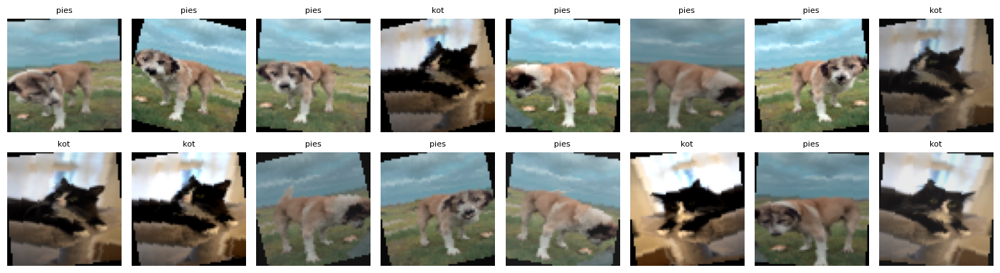
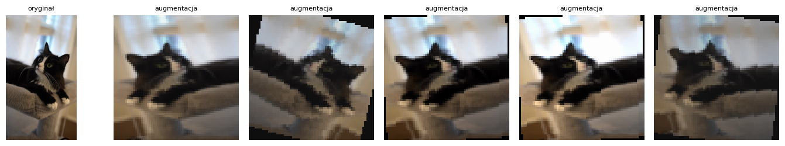

# Sprawozdanie laboratoryjne

**Przedmiot:** Uczenie głębokie do rozpoznawania obiektów
**Zajęcia nr / temat:** 3 / Dane obrazowe i wideo: potok i własny zbiór
**Autor / grupa:** Jakub Powroźnik, Gr 5.03
**Data:** 4.11.2026

## 1. Cel ćwiczenia

Celem było zbudowanie kompletnego potoku danych od plików do tensorów: przygotowanie własnego mini-zbioru obrazów w układzie `ImageFolder` (2 klasy: kot, pies) z klatek wyekstrahowanych z filmów, zdefiniowanie transformacji (wariant ewaluacyjny i treningowy z augmentacją), wczytanie zbioru przez `ImageFolder` + `DataLoader`, udokumentowanie statystyk zbioru oraz wizualna weryfikacja potoku (siatka paczki, podgląd augmentacji).

## 2. Metoda i implementacja

**Narzędzia:** Python, PyTorch 2.9.1, torchvision, OpenCV 5.0.0, matplotlib, PIL. Obliczenia na CPU. 

### Źródło danych i warunki użycia

Zbiór powstał z 4 krótkich filmów pobranych z serwisu Pexels (pexels.com):

| Plik | Klasa | Podział | Autor | Opis | Link |
|---|---|---|---|---|---|
| cat1.mp4 | kot | train | apertur 2.8 ([profil](https://www.pexels.com/pl-pl/@aperture/)) | czarno-biały puszysty kot odpoczywający w domu | [link](https://www.pexels.com/pl-pl/video/puszysty-czarno-bialy-kot-relaksujacy-sie-w-domu-35660938/) |
| cat2.mp4 | kot | val | Shuttercraftsman ([profil](https://www.pexels.com/pl-pl/@shuttercraftsman-240571253/)) | pręgowany kot ziewający na kocyku | [link](https://www.pexels.com/pl-pl/video/ziewajacy-pregowany-kot-na-przytulnym-kocyku-37904928/) |
| dog1.mp4 | pies | train | celal keser | pies stojący na trawie pod chmurami | [link](https://www.pexels.com/pl-pl/video/spokojny-pies-stoi-na-trawie-pod-chmurami-35605539/) |
| dog2.mp4 | pies | val | celal keser | zbliżenie na tureckiego psa rasy kangal | [link](https://www.pexels.com/pl-pl/video/zblizenie-na-tureckiego-psa-rasy-kangal-na-zewnatrz-39524673/) |

Wszystkie filmy pobrano 4.11.2026 na licencji Pexels (Free). Licencja pozwala na bezpłatne użycie, także w projektach edukacyjnych, bez wymogu podawania autora (autorów podano mimo to, aby udokumentować źródło). Nie wolno odsprzedawać filmów w niezmienionej formie. Filmy użyto wyłącznie w celach edukacyjnych (zaliczenie laboratorium). Filmów źródłowych ani wyodrębnionych klatek nie dołączono do repozytorium (rozmiar), w repozytorium jest log `klatki_log.csv` z indeksami i znacznikami czasu klatek.

### RODO

Nagrania przedstawiają zwierzęta i nie zawierają osób, więc nie umożliwiają identyfikacji osób fizycznych i nie stanowią danych osobowych. Gdyby w kadrze znajdowały się osoby, podstawą przetwarzania byłby cel edukacyjny, a identyfikację ograniczono by przez kadrowanie bez twarzy lub rozmycie oraz niepublikowanie zbioru.

### Ekstrakcja klatek

Klatki odczytano funkcją `cv2.VideoCapture`, próbkując co N-tą klatkę. OpenCV zwraca kanały w kolejności BGR. Do zapisu jpg użyto `cv2.imwrite` (oczekuje BGR), więc pliki mają poprawne kolory, a `ImageFolder` (PIL) wczytuje je już jako RGB. Przy bezpośrednim użyciu klatek z OpenCV w potoku wymagana jest konwersja `cv2.cvtColor(frame, cv2.COLOR_BGR2RGB)`.

| Film | FPS | Klatki (metadane) | Przeczytano | Zapisano | Co która | Odstęp nominalny |
|---|---|---|---|---|---|---|
| cat1 | 23,98 | 145 | 145 | 37 | 4. | 0,17 s |
| cat2 | 25,00 | 253 | 253 | 51 | 5. | 0,20 s |
| dog1 | 30,00 | 222 | 222 | 37 | 6. | 0,20 s |
| dog2 | 24,00 | 233 | 233 | 47 | 5. | 0,21 s |

**Uzasadnienie próbkowania.** Filmy mają różne FPS, więc zastosowano różne kroki próbkowania, aby wyrównać liczność klas w zbiorze treningowym (37/37) i przekroczyć próg 30 obrazów na klasę. Odstęp ok. 0,2 s wystarcza do uchwycenia zmian pozy zwierząt, ale zdarzenie krótsze niż ok. 0,2 s (np. mrugnięcie) mogłoby zostać pominięte. Dla ziewającego kota (cat2) ziewnięcie trwa 1-2 s, więc przy tym próbkowaniu zostaje uchwycone na kilku klatkach, natomiast przy rzadkim próbkowaniu (np. co 30. klatkę, odstęp ok. 1 s) mogłoby zostać ledwo zarejestrowane lub pominięte. Indeksy klatek i znaczniki czasu zachowano w `klatki_log.csv`. Liczba klatek z metadanych zgadza się z liczbą faktycznie przeczytanych, więc żadna klatka nie została utracona.

### Podział danych

Podział train/val wykonano **po filmach** (cat1, dog1 → train; cat2, dog2 → val), a nie losowo po klatkach, aby sąsiednie, niemal identyczne klatki nie trafiły do obu zbiorów.

Układ `ImageFolder`:
```
dane/
  train/kot, train/pies
  val/kot,   val/pies
```

### Dostępność zbioru

Folder `dane/` (klatki w układzie `ImageFolder`) nie jest dołączony do repozytorium, ponieważ zajmuje zbyt dużo miejsca (ok. 188 MB). Zbiór można w pełni odtworzyć: wystarczy pobrać cztery filmy z linków w tabeli powyżej (pod nazwami `cat1.mp4`, `cat2.mp4`, `dog1.mp4`, `dog2.mp4`, w folderze z notatnikiem) i uruchomić komórkę ekstrakcji klatek w `lab3_JP.ipynb`. Kroki próbkowania (co 4./5./6./5. klatkę) są zapisane w kodzie, a konkretne indeksy klatek w `klatki_log.csv`, więc wynik jest powtarzalny (ten sam zbiór: 37/37 w train i 51/47 w val).

### Transformacje

Rozmiar docelowy 64×64, normalizacja `mean = std = 0.5` dla 3 kanałów:
- ewaluacyjne: `Resize((64,64))` → `ToTensor` → `Normalize`,
- treningowe: `Resize((64,64))` → `RandomHorizontalFlip` → `RandomRotation(15)` → `ColorJitter(brightness=0.2, contrast=0.2)` → `ToTensor` → `Normalize`.

Augmentację zastosowano wyłącznie w wariancie treningowym; odbicie poziome i rotacja ±15° nie zmieniają etykiety kot/pies. `DataLoader`: `batch_size=16`, `shuffle=True` dla train, `shuffle=False` dla val.

## 3. Wyniki

### Statystyki zbioru

| Zbiór | Liczba klas | Razem | kot | pies |
|---|---|---|---|---|
| train | 2 | 74 | 37 | 37 |
| val | 2 | 98 | 51 | 47 |

Rozmiar po transformacji: tensor 3×64×64, paczka `(16, 3, 64, 64)`.

Mapowanie klas: `class_to_idx = {'kot': 0, 'pies': 1}` (identyczne w train i val, sprawdzone asercją w kodzie).

### Siatka przykładów z paczki

Paczka z `train_dl` (po augmentacji, z odwróconą normalizacją na potrzeby podglądu):



### Podgląd augmentacji na jednym obrazie

Oryginał oraz 5 losowych wariantów augmentacji tego samego obrazu:



## 4. Analiza i interpretacja

Potok działa poprawnie: kształty tensorów, etykiety i mapowanie klas są zgodne z oczekiwaniami, a etykiety na siatce paczki odpowiadają zawartości obrazów (kontrola jednej paczki przed dalszą pracą).

Augmentacja zwiększa różnorodność wariantów treningowych (obrót z czarnymi rogami, zmiana jasności i kontrastu, odbicie poziome) i zachowuje etykietę.

Wszystkie filmy źródłowe są pionowe (9:16, np. 2160×3840), a `Resize((64,64))` ściska je do kwadratu bez zachowania proporcji, więc obrazy są rozciągnięte w poziomie (ok. 1,8×). Zniekształcenie jest takie samo w train i val, więc nie psuje spójności potoku, ale zmienia wygląd obiektów. Alternatywą jest `Resize(64)` + `CenterCrop(64)` albo `Resize((112, 64))`.

Ograniczenia zbioru: bardzo mały rozmiar (74 obrazy treningowe) i tylko po jednym filmie na klasę w każdym podziale. Klatki z jednego filmu są silnie skorelowane (to samo tło, to samo zwierzę, to samo oświetlenie), więc zbiór walidacyjny jest niezależny jedynie częściowo, a klasa może być mylona z tłem (trawa, wnętrze domu) zamiast cechami zwierzęcia. Wyniki klasyfikacji na takim zbiorze nie uogólniałyby się na inne nagrania. Przy jednym filmie na klasę w każdym podziale niezależna ocena modelu jest ograniczona.

## 5. Wnioski

Zbudowano kompletny potok od wideo do tensorów: ekstrakcja klatek (z logiem indeksów i czasu), układ `ImageFolder`, osobne transformacje treningowe i ewaluacyjne, `DataLoader`, statystyki oraz wizualna weryfikacja paczki i augmentacji. Podział po filmach ogranicza przeciek informacji między zbiorami train i val, a zróżnicowanie kroku próbkowania pozwoliło wyrównać liczność klas mimo różnych FPS filmów. Ze względu na rozmiar zbiór nie jest w repozytorium, ale jest odtwarzalny z filmów źródłowych za pomocą notatnika.

Kierunki poprawy: więcej filmów na klasę (różne sceny, oświetlenie i tła), zachowanie proporcji przy skalowaniu (`Resize` + `CenterCrop`), dodatkowe augmentacje oraz trening prostego klasyfikatora (MLP lub CNN) w celu realnej oceny jakości zbioru.