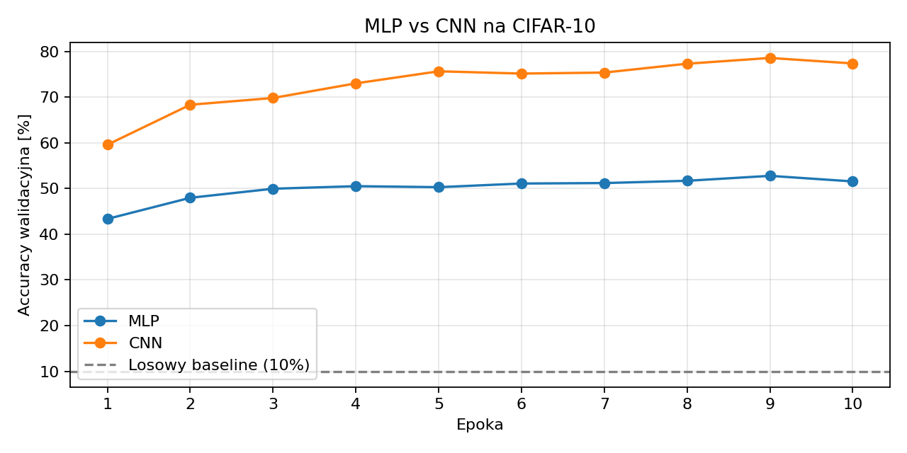

# Sprawozdanie laboratoryjne

**Przedmiot:** Uczenie głębokie do rozpoznawania obiektów  
**Zajęcia nr / temat:** 4 / CNN — splotowe sieci dla obrazów  
**Autor / grupa:** Jakub Powroźnik Gr Lab 5.03
**Data:** 13.11.2026

## 1. Cel ćwiczenia

Celem ćwiczenia było porównanie wielowarstwowego perceptronu (MLP) i prostej sieci splotowej (CNN) w klasyfikacji obrazów ze zbioru CIFAR-10. Porównanie obejmowało końcową accuracy testową, liczbę parametrów i czas uczenia. MLP posłużył jako model odniesienia.

## 2. Metoda i implementacja

Implementacja w Pythonie z użyciem PyTorch, torchvision i Matplotlib znajduje się w notebooku [lab04.ipynb](lab04.ipynb).

**Dane.** CIFAR-10 zawiera kolorowe obrazy o rozmiarze 32 × 32 piksele w 10 klasach. Z oficjalnej części treningowej wydzielono 45 000 obrazów do treningu i 5 000 do walidacji. Do końcowej oceny wykorzystano oficjalny zbiór testowy liczący 10 000 obrazów. Dla obu modeli zastosowano ten sam podział i normalizację kanałów RGB. Nie stosowano augmentacji.

**MLP.** Spłaszczenie obrazu do 3 072 wartości, dwie warstwy ukryte o rozmiarach 512 i 256 z aktywacją ReLU oraz warstwa wyjściowa z 10 logitami.

**CNN.** Dwa bloki splotowe z 32 i 64 kanałami. Każdy blok zawiera dwa sploty 3 × 3 z normalizacją wsadową i ReLU, a następnie max pooling 2 × 2. Klasyfikator zawiera warstwę ukrytą z 256 jednostkami, ReLU, dropout 0,3 i warstwę wyjściową z 10 logitami.

**Trening i ocena.** Oba modele uczono przez 10 epok, stosując Adam ze współczynnikiem uczenia 0,001, rozmiar partii 128 i funkcję straty entropii krzyżowej. Dla każdego modelu wybrano wagi z epoki o najwyższej accuracy walidacyjnej. Wybrane wagi oceniono na zbiorze testowym po zakończeniu treningu obu modeli.

## 3. Wyniki

**Sprzęt użyty do pomiaru:** MPS. Czas obejmuje trening i walidację po każdej epoce.

| Model | Liczba parametrów | Końcowa accuracy testowa | Czas uczenia [s] | Epoka wybrana na walidacji |
|---|---:|---:|---:|---:|
| MLP | 1 707 274 | 52.99% | 34.8 | 9 |
| CNN | 1 117 354 | 78.87% | 99.0 | 9 |

Poziom odniesienia dla losowego zgadywania w 10 klasach wynosi 10%. Accuracy testowa MLP była o 42,99 pkt proc. wyższa od tego poziomu, a accuracy testowa CNN o 68,87 pkt proc.

## 4. Analiza i interpretacja

CNN miała wyższą accuracy walidacyjną w każdej epoce. MLP po początkowym wzroście utrzymywał się w okolicach 50–53%, a CNN wzrosła z około 60% do 79%. Oba modele osiągnęły najlepszy wynik walidacyjny w 9. epoce.

Na zbiorze testowym CNN uzyskała 78,87%, czyli o 25,88 pkt proc. więcej niż MLP (52,99%). Lokalność i współdzielenie wag mogły pomóc CNN wykrywać te same wzorce w różnych miejscach obrazu. CNN miała o 34,6% mniej parametrów, ale jej trening z walidacją trwał około 2,84 raza dłużej (99,0 s wobec 34,8 s).

## 5. Wnioski

CNN osiągnęła 78,87% accuracy testowej, czyli o 25,88 pkt proc. więcej niż MLP (52,99%), przy około 34,6% mniejszej liczbie parametrów. Jej trening wraz z walidacją trwał około 2,84 razy dłużej (99,0 s wobec 34,8 s). Dla obu modeli najwyższą accuracy walidacyjną uzyskano w 9. epoce.