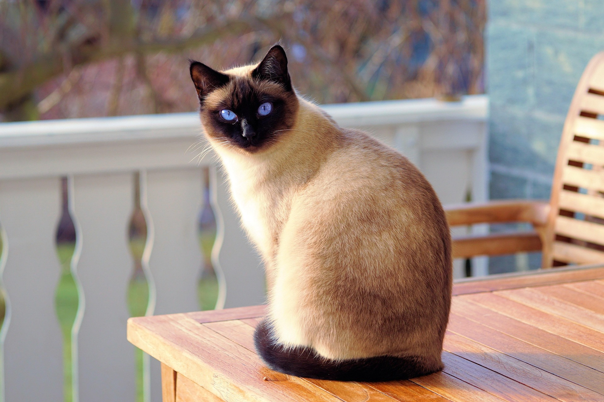
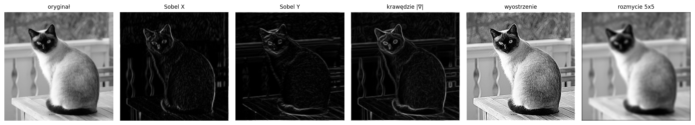
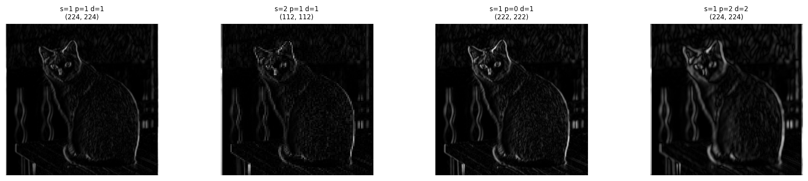
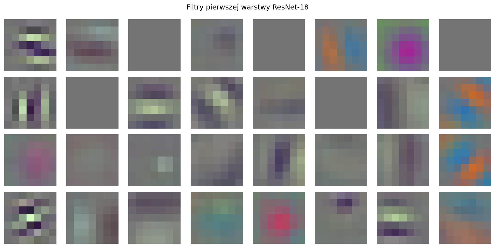
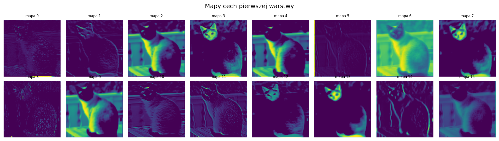
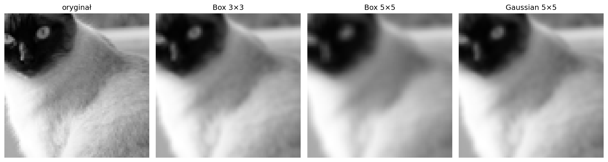

# Sprawozdanie laboratoryjne

**Przedmiot:** Uczenie głębokie do rozpoznawania obiektów
**Zajęcia nr / temat:** 5 — Warstwy splotowe: operacja, parametry, interpretacja
**Autor / grupa:** Jakub Powroźnik Gr. Lab 5.03
**Data:** 13.11.2026

## 1. Cel ćwiczenia

Celem ćwiczenia było zbadanie działania pojedynczej warstwy splotowej na własnym zdjęciu w skali szarości. Zakres obejmował: zastosowanie ręcznych jąder (Sobel, wyostrzanie, rozmycie) przez `F.conv2d`, sprawdzenie wzoru na wymiar wyjścia względem `nn.Conv2d`, zbadanie wpływu `stride`, `padding` i `dilation`, interpretację filtrów i map cech pierwszej warstwy pretrenowanego ResNet-18 oraz porównanie filtrów rozmywających Box 3×3, Box 5×5 i Gaussian 5×5.

**Zdjęcie użyte w sprawozdaniu** (przed filtracją, skala szarości, kadr 224×224 wycięty ze środka oryginału 1920×1008):



## 2. Metoda i implementacja

**Narzędzia:** Python, PyTorch, torchvision (ResNet-18 z wagami `ResNet18_Weights.DEFAULT`), matplotlib, PIL.

**Przygotowanie obrazu.** Zdjęcie 1920×1008 zamieniono na skalę szarości (`convert("L")`), potem z powrotem na 3 identyczne kanały (`convert("RGB")`), żeby pasowało do wejścia ResNet-18. Aby uniknąć zniekształcenia proporcji, wycięto kwadrat ze środka (1008×1008) i przeskalowano go do 224×224. Do ręcznych jąder użyto tensora `gray` o kształcie `[1, 1, 224, 224]` (średnia z 3 kanałów).

```python
pil = Image.open("kot.jpg").convert("L").convert("RGB")
w, h = pil.size
m = min(w, h)
left, top = (w - m) // 2, (h - m) // 2
pil = pil.crop((left, top, left + m, top + m)).resize((224, 224))
rgb = torch.from_numpy(np.array(pil)).float().permute(2, 0, 1).unsqueeze(0) / 255.0
gray = rgb.mean(1, keepdim=True)
```

**Ręczne jądra.** Użyto Sobela X i Y (wyświetlono wartości bezwzględne gx.abs() i gy.abs()), jądra wyostrzającego (środek +5, czterej sąsiedzi −1) oraz rozmycia Box 5×5. Wszystkie przez F.conv2d z padding = k // 2, aby zachować rozmiar obrazu. Krawędzie Sobela połączono w magnitudę sqrt(gx² + gy²).

**Wzór na wymiar wyjścia:**

```
out = floor((in + 2p - d(k-1) - 1) / s) + 1
```

Wzór zaimplementowano jako funkcję `out_dim` i porównano z rzeczywistym wyjściem `nn.Conv2d(3, 8, ...)` dla wejścia 32×32.

**Interpretacja sieci.** Z pretrenowanego ResNet-18 pobrano wagi `conv1` (64 filtry, każdy 3×7×7) i wyświetlono je jako małe obrazy RGB (po przeskalowaniu do zakresu 0–1). Mapy cech uzyskano jako `relu(model.conv1(x))` dla zdjęcia po preprocessingu modelu (64 mapy 112×112).

**Filtry rozmywające.** Jądra: Box 3×3 (wagi 1/9), Box 5×5 (wagi 1/25), Gaussian 5×5 (iloczyn zewnętrzny wektora `[1, 4, 6, 4, 1]` ze sobą, dzielony przez 256). We wszystkich `stride=1`, `dilation=1`, `padding=1` dla 3×3 i `padding=2` dla 5×5. Wszystkie jądra mają sumę wag równą 1.

```python
box3 = torch.ones(1, 1, 3, 3) / 9.0
box5 = torch.ones(1, 1, 5, 5) / 25.0
g = torch.tensor([1., 4., 6., 4., 1.])
gauss5 = (g[:, None] * g[None, :] / 256.0).view(1, 1, 5, 5)

b3 = F.conv2d(gray, box3, padding=1)
b5 = F.conv2d(gray, box5, padding=2)
g5 = F.conv2d(gray, gauss5, padding=2)
```

Cały obraz filtrowano przed wycięciem fragmentu, aby brzegi wycinka nie były zniekształcone paddingiem. Fragment wyświetlono na wspólnej skali jasności (`vmin=0, vmax=1`).


## 3. Wyniki

### 3.1 Ręczne jądra



### 3.2 Wymiary wyjścia — wzór vs `nn.Conv2d` (wejście 32×32)

| k | s | p | d | wzór | `nn.Conv2d` | zgodność |
|---|---|---|---|------|-------------|----------|
| 3 | 1 | 1 | 1 | 32 | 32 | ✓ |
| 3 | 2 | 1 | 1 | 16 | 16 | ✓ |
| 5 | 1 | 2 | 1 | 32 | 32 | ✓ |
| 3 | 1 | 2 | 2 | 32 | 32 | ✓ |
| 7 | 2 | 3 | 1 | 16 | 16 | ✓ |


### 3.3 Wpływ stride, padding i dilation (Sobel X, wejście 224×224)



| ustawienia | rozmiar wyjścia |
|---|---|
| s=1, p=1, d=1 | 224×224 |
| s=2, p=1, d=1 | 112×112 |
| s=1, p=0, d=1 | 222×222 |
| s=1, p=2, d=2 | 224×224 |

### 3.4 Filtry i mapy cech ResNet-18 (`conv1`)





### 3.5 Porównanie filtrów rozmywających

Ten sam fragment zdjęcia (głowa kota) przed filtracją i po każdym filtrze, wspólna skala jasności:



## 4. Analiza i interpretacja

### 4.1 Ręczne jądra

**Sobel X** odejmuje lewą kolumnę okna od prawej, więc reaguje na zmianę jasności w poziomie, czyli na **pionowe krawędzie**. Na zdjęciu mocniej zaznaczył m.in. pionowe słupki balustrady i boki sylwetki kota.

**Sobel Y** porównuje górny i dolny wiersz, więc reaguje na **poziome krawędzie**, np. deski blatu i linie pod kotem.

**Magnituda gradientu** łączy oba kierunki i pokazuje siłę zmiany jasności niezależnie od kierunku, więc widać cały kontur kota, oczy i uszy. Obrazy Sobela są ciemne, bo większość zdjęcia to gładkie obszary, gdzie odpowiedź jest bliska zeru.

**Wyostrzenie** (środek +5, sąsiedzi −1, suma wag 1) zwiększa lokalny kontrast przy krawędziach, więc futro i oczy są wyraźniejsze. Wynik może wyjść poza zakres 0–1, dlatego zastosowano `clamp(0, 1)`.

**Rozmycie 5×5** zastępuje piksel średnią z okna, więc drobne detale znikają, a przejścia na krawędziach łagodnieją.

### 4.2 Wymiary wyjścia

Wzór zgadza się z `nn.Conv2d` we wszystkich pięciu konfiguracjach. Przy `s=1` rozmiar jest zachowany, gdy `2p = d(k-1)` (np. `k=3, p=1, d=1` oraz `k=3, p=2, d=2`). Przy `s=2` wymiar zmniejsza się około dwukrotnie (32 → 16), bo okno przesuwa się co dwa piksele.

### 4.3 Stride, padding, dilation

**stride=2** daje mapę 112×112, czyli rzadszą siatkę odpowiedzi i niższą rozdzielczość.

**padding=0** daje 222×222: bez ramki z zer okno nie może być wyśrodkowane na pikselach brzegowych, więc tracimy po jednym pikselu z każdej strony.

**dilation=2** rozciąga okno 3×3 do zasięgu 5×5 przy tej samej liczbie wag (9). Jądro widzi szerszy kontekst, a rozmiar wyjścia udało się zachować dopiero przy `padding=2`.

### 4.4 ResNet-18, pierwsza warstwa

**Filtry (wagi `conv1`).** Część filtrów wygląda jak detektory krawędzi o różnej orientacji (pasy poziome, pionowe, ukośne), czyli podobnie do Sobela, ale nauczone z danych. Inne to plamy barwne (magenta, czerwień, kontrast pomarańczowo-niebieski), reagujące na kontrast kolorów. Część filtrów jest prawie jednolicie szara, czyli ma wagi bliskie zeru.

**Mapy cech.** Dla zdjęcia w skali szarości zaobserwowano m.in.:

- mapy 3, 7, 12, 13 silnie podświetlają głowę i uszy kota (ciemne, kontrastowe obszary),
- mapy 2, 4, 9 reagują na jasny bok kota i oświetlone deski,
- mapa 6 reaguje głównie na ogólną jasność tła,
- mapy 1, 5, 11, 14 pokazują cienkie kontury, podobnie do Sobela (np. pionowe słupki balustrady),
- mapy 0 i 8 są prawie puste lub wyglądają jak szum, więc te filtry nie znajdują tu istotnego wzorca.

Ponieważ to pierwsza warstwa, reaguje ona tylko na proste cechy (krawędzie, jasność, kontrast), a nie na „kota" jako obiekt. Filtry barwne mają ograniczone znaczenie, bo zdjęcie jest szare, a we wszystkich kanałach ma tę samą wartość.

### 4.5 Box 3×3 vs Box 5×5 vs Gaussian 5×5

**Box 3×3 vs Box 5×5.** Większe jądro uśrednia 25 pikseli zamiast 9, więc rozmycie jest mocniejsze. Przy 3×3 oko i ciemne kreski przy pysku kota są jeszcze czytelne, a przy 5×5 oko jest blade i rozlane, kreski prawie znikają, a granica głowy i futra jest szersza i miękka. Drobny detal znika wcześniej niż duże struktury.

**Box 5×5 vs Gaussian 5×5.** Okno jest takie samo, ale rozkład wag inny. Box daje każdemu z 25 pikseli wagę 1/25, więc piksele z rogów okna wpływają tak samo mocno jak środkowy. Gaussian daje środkowi wagę 36/256, a rogom tylko 1/256, więc wynik jest bardziej oparty na pikselu, który liczymy. Dlatego Gaussian lepiej zachował oko i kreski, a obraz wygląda bardziej naturalnie, podczas gdy Box 5×5 jest bardziej „zamydlony".

**Ograniczenia.** Wnioski dotyczą jednego zdjęcia i jednego wybranego fragmentu. Opisy map cech są jakościowe (oceniane wzrokiem), bez miary ilościowej.

## 5. Wnioski

1. Warstwa splotowa liczy ważoną sumę lokalnego okna, a wagi jądra decydują o reakcji: Sobel wykrywa krawędzie, Sharpen wzmacnia kontrast, Box i Gaussian wygładzają.
2. Wzór `out = floor((in + 2p - d(k-1) - 1)/s) + 1` poprawnie przewiduje rozmiar wyjścia `nn.Conv2d` we wszystkich testowanych konfiguracjach.
3. `stride` zmniejsza rozdzielczość mapy, `padding` pozwala zachować rozmiar (przy `s=1` wystarczy `2p = d(k-1)`), a `dilation` zwiększa zasięg okna bez zwiększania liczby wag.
4. Filtry pierwszej warstwy ResNet-18 przypominają ręczne detektory krawędzi i plam barwnych, ale są nauczone z danych, a mapy cech pokazują, w których miejscach zdjęcia dany filtr silnie reaguje.
5. Przy tym samym rozmiarze okna Gaussian rozmywa łagodniej niż Box, bo największą wagę ma środek okna.

**Kierunki rozszerzenia:** porównanie filtrów pierwszej i głębszej warstwy sieci, własne jądro do wykrywania krawędzi ukośnych, porównanie liczby parametrów `Conv2d(C_in, C_out, k)` z warstwą gęstą.
