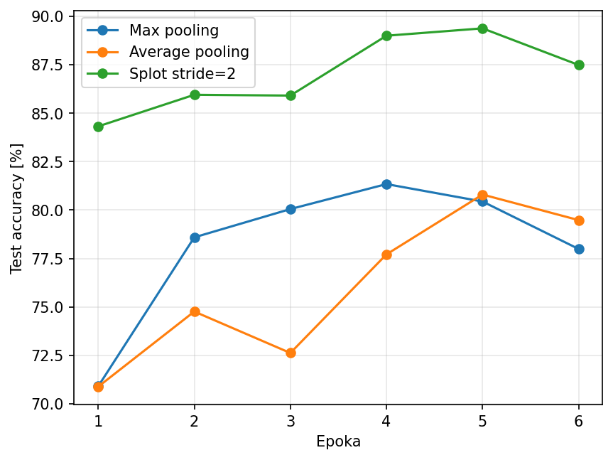

# Sprawozdanie laboratoryjne

**Przedmiot:** Uczenie głębokie do rozpoznawania obiektów
**Zajęcia nr / temat:** 6 — Warstwa łącząca (pooling) i pełna CNN
**Autor / grupa:** Jakub Powroźnik Gr lab 5.03
**Data:** 18.11.2026

## 1. Cel ćwiczenia

Celem ćwiczenia było zbudowanie kompletnej sieci splotowej (CNN) i zbadanie wpływu sposobu redukcji wymiaru przestrzennego na wynik klasyfikacji oraz na architekturę. Porównano trzy warianty redukcji: max pooling, average pooling oraz splot z krokiem 2 (stride=2). Dla każdego wariantu wyznaczono accuracy, liczbę parametrów i rozmiar mapy cech przed głowicą klasyfikującą, a następnie omówiono kompromis między jakością a liczbą parametrów.

## 2. Metoda i implementacja

**Narzędzia i dane:** PyTorch, torchvision, matplotlib. Zbiór FashionMNIST (60 000 obrazów treningowych i 10 000 testowych, 28×28, skala szarości, 10 klas), normalizacja średnią 0,2860 i odchyleniem 0,3530. Obliczenia wykonano na CPU.

**Architektura.** Sieć składa się z dwóch bloków i głowicy:

- Blok: `Conv2d(3×3, padding=1)` → `BatchNorm2d` → `ReLU` → redukcja. Pierwszy blok ma 32 filtry, drugi 64.
- Redukcja (jedyny element różniący warianty):
  - `max`: `MaxPool2d(2)`,
  - `avg`: `AvgPool2d(2)`,
  - `stride`: dodatkowy `Conv2d(3×3, stride=2, padding=1)` → `BatchNorm2d` → `ReLU`.
- Głowica (wspólna): `AdaptiveAvgPool2d(1)` (GAP) → `Flatten` → `Linear(64, 10)`.

```python
class CNN(nn.Module):
    def __init__(self, n_classes=10, pool="max"):
        super().__init__()
        def block(cin, cout):
            layers = [nn.Conv2d(cin, cout, 3, padding=1), nn.BatchNorm2d(cout), nn.ReLU()]
            if pool == "max":
                layers.append(nn.MaxPool2d(2))
            elif pool == "avg":
                layers.append(nn.AvgPool2d(2))
            elif pool == "stride":
                layers += [nn.Conv2d(cout, cout, 3, stride=2, padding=1),
                           nn.BatchNorm2d(cout), nn.ReLU()]
            return nn.Sequential(*layers)
        self.features = nn.Sequential(block(1, 32), block(32, 64))  # 28 -> 14 -> 7
        self.head = nn.Sequential(nn.AdaptiveAvgPool2d(1), nn.Flatten(),
                                  nn.Linear(64, n_classes))
    def forward(self, x):
        return self.head(self.features(x))
```

**Konfiguracja treningu (identyczna dla wszystkich wariantów):** optymalizator Adam, `lr=1e-3`, funkcja straty CrossEntropyLoss, batch 128 (trening) i 256 (test), 6 epok, ten sam podział train/test. Przed utworzeniem każdego modelu ustawiono `torch.manual_seed(0)`, aby start był porównywalny. Accuracy testowe mierzono po każdej epoce. Brak augmentacji danych.

Pełny kod: notatnik `lab06_jp.ipynb` w repozytorium [LINK DO REPOZYTORIUM].

## 3. Wyniki

Rozmiar mapy cech przed głowicą zmierzono, przepuszczając tensor `[2, 1, 28, 28]` przez `model.features`. Dla wszystkich wariantów wyszedł kształt `(2, 64, 7, 7)`, czyli 64×7×7 na obraz.

| Wariant redukcji | Best acc (test) | Acc po 6. epoce (test) | Parametry | Mapa przed głowicą |
|---|---|---|---|---|
| Max pooling | 81,34% | ≈78,0% | 19 658 | 64×7×7 |
| Average pooling | 80,80% | ≈79,5% | 19 658 | 64×7×7 |
| Splot stride=2 | 89,38% | ≈87,5% | 66 026 | 64×7×7 |

*Best acc to najwyższa wartość accuracy testowego z 6 epok. Wartości po 6. epoce odczytano z wykresu.*

**Krzywe accuracy:**



**Skąd biorą się parametry.** Max i average pooling nie mają uczonych parametrów, dlatego oba modele mają po 19 658 parametrów (konwolucje, BatchNorm i warstwa `Linear` z 650 parametrami). Wariant stride dodaje w każdym bloku splot 3×3 i BatchNorm: 9 312 parametrów w pierwszym bloku (32·32·9 + 32 + 64) oraz 37 056 w drugim (64·64·9 + 64 + 128), razem 46 368. Stąd 19 658 + 46 368 = 66 026.

## 4. Analiza i interpretacja

**Kształt map.** Wszystkie trzy warianty redukują mapę o połowę w każdym bloku (28 → 14 → 7), więc na wejściu głowicy mają identyczny tensor 64×7×7, a GAP daje 64 cechy i 650 parametrów w warstwie `Linear`. Różnice w liczbie parametrów i accuracy wynikają więc wyłącznie z operacji redukcji.

**Max vs average pooling.** Różnica best acc wynosi 0,54 p.p. (81,34% vs 80,80%), a accuracy po 6. epoce ma odwrotną kolejność (avg wyższy o ok. 1,5 p.p.). Krzywe przecinają się w epoce 5, a accuracy obu wariantów zmienia się między epokami o kilka punktów procentowych. Różnicę między max a avg uznaję więc za nieistotną na podstawie tego eksperymentu. Max pooling uczył się szybciej w pierwszych epokach (epoka 2: ok. 78,6% vs 74,8%), co jest zgodne z tym, że zachowuje najsilniejszą odpowiedź filtra, podczas gdy uśrednianie ją rozmywa.

**Stride vs pooling.** Splot z krokiem 2 osiągnął ok. 8 p.p. wyższe accuracy (89,38% vs ok. 81%) przy 3,4 razy większej liczbie parametrów (66 026 vs 19 658). Różnica jest duża w porównaniu z wahaniami między epokami, a krzywa stride leży wyraźnie powyżej pozostałych w każdej epoce. Trzeba jednak zaznaczyć, że wariant stride jest nie tylko „uczoną redukcją”, ale też głębszą siecią (cztery warstwy splotowe zamiast dwóch) z dodatkowymi BatchNorm i ReLU. Obserwowana poprawa wynika więc z połączenia uczonej redukcji i większej pojemności modelu. Rozdzielenie tych efektów wymagałoby osobnego eksperymentu, np. porównania z siecią pooling o czterech splotach.

**Kompromis jakość/parametry.** Pooling jest „darmową” operacją: nie dodaje parametrów, a mały model (19,7 tys.) osiąga ok. 81%. Splot z krokiem kosztuje 46 tys. dodatkowych parametrów i daje znaczący wzrost accuracy. W zastosowaniach, gdzie liczy się rozmiar modelu, wystarcza pooling, a gdy liczy się jakość, opłaca się uczona redukcja.

**Ograniczenia.**
- Każdy wariant trenowano jeden raz (seed 0), bez powtórzeń, więc nie oszacowano rozrzutu wyników.
- „Best acc” wybrano na zbiorze testowym, więc lekko zawyża oczekiwany wynik. Nie użyto osobnego zbioru walidacyjnego.
- Accuracy między epokami wyraźnie waha się (np. max pooling spada z ok. 81,3% w epoce 4 do ok. 78,0% w epoce 6), co wskazuje, że 6 epok i stała stopa uczenia nie dają ustabilizowanych wyników.
- Wyniki różnią się o 0,5–0,8 p.p. od wyników z notatnika zajęciowego (81,83% / 80,05% / 89,86%) przy tej samej kolejności wariantów, co jest zgodne z losowością treningu.

## 5. Wnioski

1. Wszystkie trzy warianty dają na wejściu głowicy mapę 64×7×7, a liczba parametrów różni się tylko tam, gdzie redukcja jest uczona: max i average pooling mają po 19 658 parametrów, splot z krokiem 66 026.
2. Max i average pooling dały porównywalne accuracy (81,34% vs 80,80%). Przy jednym przebiegu na wariant nie można wskazać lepszego.
3. Splot z krokiem 2 dał najlepszy wynik (89,38%), kosztem 3,4 razy większej liczby parametrów. Przewaga wynika częściowo z większej głębokości sieci, nie tylko z samej uczonej redukcji.
4. Kierunki poprawy: uruchomienie każdego wariantu dla kilku seedów i podanie średniej z odchyleniem standardowym, użycie zbioru walidacyjnego do wyboru epoki, dłuższy trening z harmonogramem stopy uczenia. Można też wykonać części dodatkowe zadania: porównanie okna 2×2 i 3×3 oraz GAP vs `Flatten` + `Linear` (3136 cech, 31 370 parametrów w warstwie `Linear` zamiast 650).

---
